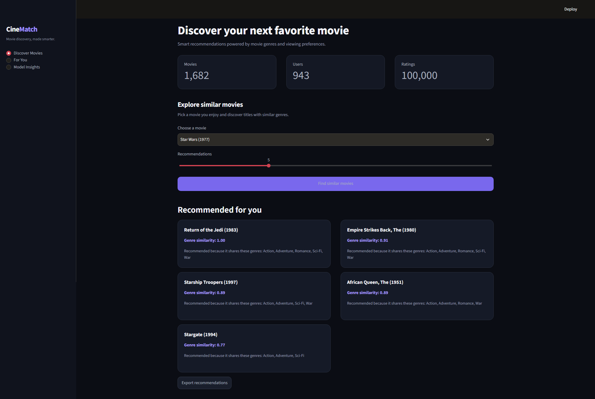
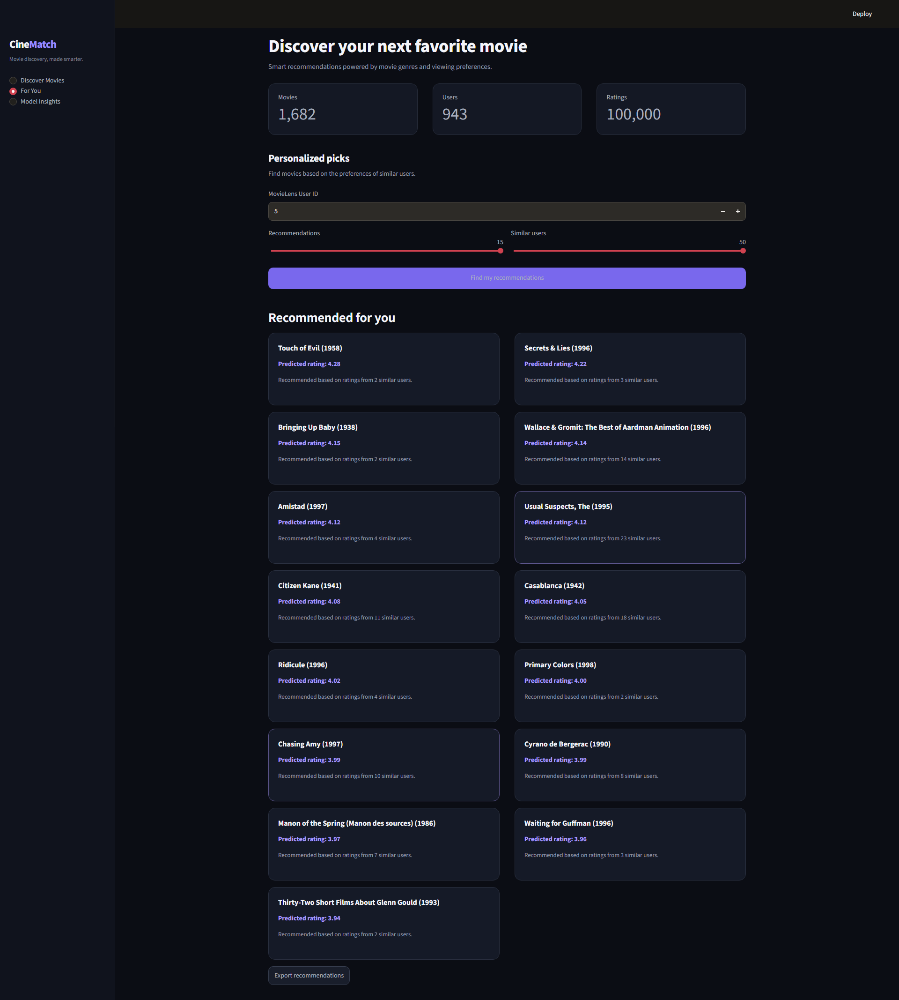
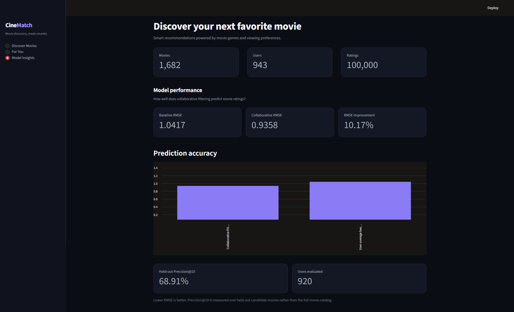

# CineMatch — Movie Recommendation System

**An interactive movie recommendation system built with Python, Streamlit, Pandas, NumPy, and scikit-learn.**

CineMatch combines content-based filtering and user-based collaborative filtering to recommend movies using genre similarities and user rating preferences.

The project includes an interactive web interface, recommendation explanations, exploratory data analysis, and model evaluation using RMSE and held-out candidate Precision@10.

## Features

- **Content-Based Recommendations:** Discover movies with similar genres using cosine similarity.
- **Collaborative Filtering:** Generate personalized recommendations based on ratings from similar users.
- **Interactive Web Application:** Explore recommendations through a modern Streamlit interface.
- **Recommendation Explanations:** Understand which genres or similar-user signals support each recommendation.
- **Model Evaluation:** Compare collaborative filtering against a user-average baseline.
- **Data Analysis:** Explore popular movies, average ratings, and user activity.
- **CSV Export:** Download recommendations and evaluation results.

## Application Screenshots

### Discover Movies

Select a movie and explore recommendations based on genre similarity.



### For You

Generate personalized recommendations using a MovieLens user ID.



### Model Insights

Explore the model's performance and evaluation results.



## Dataset

The project uses the **MovieLens 100K dataset**, developed by GroupLens Research at the University of Minnesota.

| Dataset Property | Value                |
| ---------------- | -------------------- |
| Ratings          | 100,000              |
| Users            | 943                  |
| Movies           | 1,682                |
| Rating scale     | 1–5                  |
| Movie genres     | 19 indicator columns |

Dataset source: https://grouplens.org/datasets/movielens/100k/

The dataset contains user ratings, movie information, and genre indicators.

## Technologies

| Technology   | Purpose                                   |
| ------------ | ----------------------------------------- |
| Python       | Core application and algorithms           |
| Streamlit    | Interactive web application               |
| Pandas       | Data processing and analysis              |
| NumPy        | Numerical computations                    |
| scikit-learn | Cosine similarity and model evaluation    |
| Git & GitHub | Version control and project documentation |

## Recommendation Algorithms

### 1. Content-Based Filtering

Content-based filtering recommends movies with similar genre characteristics.

The system:

1. Loads movie metadata from the MovieLens dataset.
2. Represents each movie using binary genre features.
3. Calculates cosine similarity between movie vectors.
4. Ranks movies by similarity to the selected title.
5. Returns recommendations with similarity scores and shared-genre explanations.

**Example:**

When selecting _Star Wars (1977)_, the system recommends titles such as:

- Return of the Jedi (1983)
- The Empire Strikes Back (1980)
- Starship Troopers (1997)

These recommendations are based on shared genre features rather than plot or narrative similarity.

### 2. User-Based Collaborative Filtering

Collaborative filtering recommends movies based on the rating preferences of similar users.

The system:

1. Creates a user–movie rating matrix.
2. Centers ratings around each user's average rating.
3. Calculates cosine similarity between users.
4. Identifies the most similar users.
5. Predicts ratings using similarity-weighted rating deviations.
6. Recommends unseen movies with high predicted ratings.

The application allows users to select a MovieLens user ID, adjust the number of similar users, and generate personalized recommendations.

## Model Evaluation

The collaborative filtering model was evaluated using an **80/20 random rating-level train-test split** of MovieLens 100K.

A user-average baseline was used for comparison.

### Evaluation Results

| Metric                          | Result |
| ------------------------------- | -----: |
| Training ratings                | 80,000 |
| Testing ratings                 | 20,000 |
| Baseline RMSE                   | 1.0417 |
| Collaborative Filtering RMSE    | 0.9358 |
| RMSE Reduction                  | 10.17% |
| Held-out Candidate Precision@10 | 68.91% |
| Users Evaluated                 |    920 |

### Results Interpretation

The collaborative filtering model achieved an RMSE of **0.9358**, compared with **1.0417** for the user-average baseline.

This represents a **10.17% reduction in RMSE**, indicating improved rating prediction accuracy on the held-out test set.

The held-out candidate Precision@10 was **68.91%**. For this evaluation, the model ranked up to 10 held-out rated movies per eligible user, with ratings of 4 or 5 considered relevant.

This metric is not full-catalog Precision@10 and should not be compared directly with recommendation benchmarks that rank all unseen movies.

## Project Structure

```text
Movie_Recommendation_System/
│
├── data/
│   ├── u.data
│   ├── u.item
│   └── u.genre
│
├── outputs/
│   ├── most_rated_movies.csv
│   ├── top_rated_movies.csv
│   ├── movie_statistics.csv
│   ├── user_activity.csv
│   ├── content_recommendations.csv
│   ├── collaborative_recommendations.csv
│   └── evaluation_results.csv
│
├── screenshots/
│   ├── discover-movies.png
│   ├── for-you.png
│   └── model-insights.png
│
├── src/
│   ├── content_based.py
│   ├── collaborative.py
│   └── evaluate.py
│
├── app.py
├── main.py
├── requirements.txt
├── .gitignore
└── README.md
```

The `data/` directory must contain the required MovieLens files before running the application. The raw dataset can be downloaded separately if it is not included in the repository.

## Installation and Setup

### 1. Clone the Repository

```bash
git clone https://github.com/SyedMAhmed777/movie-recommendation-system.git
cd movie-recommendation-system
```

### 2. Create a Virtual Environment

```bash
python -m venv .venv
```

Activate it on Windows Command Prompt:

```cmd
.venv\Scripts\activate.bat
```

For Windows PowerShell, you can also use the virtual environment's Python executable directly without activation.

### 3. Install Dependencies

```bash
python -m pip install -r requirements.txt
```

Required libraries:

- pandas
- numpy
- scikit-learn
- streamlit

### 4. Download the Dataset

Download the MovieLens 100K dataset:

https://files.grouplens.org/datasets/movielens/ml-100k.zip

Extract the archive and copy these files into the `data/` directory:

```text
data/
├── u.data
├── u.item
└── u.genre
```

### 5. Run the Interactive Application

```bash
python -m streamlit run app.py
```

Open the local application at:

http://localhost:8501

## Using CineMatch

### Discover Movies

1. Open the **Discover Movies** section.
2. Select a movie from the dropdown.
3. Choose the number of recommendations.
4. Click **Find similar movies**.
5. View the recommended titles, genre similarity scores, and explanations.
6. Export the results to CSV if needed.

### For You

1. Open the **For You** section.
2. Enter a valid MovieLens user ID.
3. Select the number of recommendations and similar users.
4. Click **Find my recommendations**.
5. Review personalized movie recommendations and predicted ratings.

### Model Insights

Open **Model Insights** to view the RMSE comparison, improvement percentage, and held-out candidate ranking metric.

The evaluation data is loaded from `outputs/evaluation_results.csv`.

If this file is missing, run the evaluation script first.

## Running Individual Python Scripts

The project can also be executed without the Streamlit interface.

### Exploratory Data Analysis

```bash
python main.py
```

Loads the dataset, analyzes rating patterns, and saves statistical reports.

### Content-Based Recommendations

```bash
python src/content_based.py
```

Generates recommendations using genre-based cosine similarity.

### Collaborative Filtering

```bash
python src/collaborative.py
```

Generates personalized recommendations using similar users' rating patterns.

### Model Evaluation

```bash
python src/evaluate.py
```

Calculates baseline RMSE, collaborative filtering RMSE, RMSE improvement, and held-out candidate Precision@10.

Evaluation results are saved to:

`outputs/evaluation_results.csv`

## Limitations

- Content-based filtering uses genre indicators rather than plot descriptions or semantic embeddings.
- Movies with identical genre vectors can receive identical similarity scores.
- Collaborative filtering may struggle with new users and movies with limited ratings.
- Predicted ratings can be influenced by a small number of similar users.
- The evaluation uses a random rating-level split rather than a chronological split.
- Held-out candidate Precision@10 is not a full-catalog recommendation metric.
- The prototype does not use live movie information or real-time user activity.
- MovieLens user IDs represent dataset users, not accounts created in CineMatch.

## Future Improvements

- Hybrid recommendations combining content-based and collaborative filtering
- Movie posters and additional movie metadata
- Full-catalog recommendation evaluation
- Recall@K and NDCG evaluation
- Improved handling of cold-start users and movies
- Semantic similarity using movie descriptions
- User profiles and saved recommendation lists
- Online deployment of the Streamlit application

## Author

**Muhammad Ahmed**

Computer Science Graduate | UI/UX & Product Designer

GitHub: https://github.com/SyedMAhmed777

---
